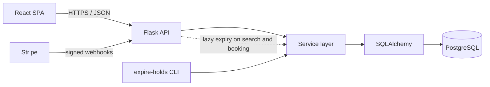
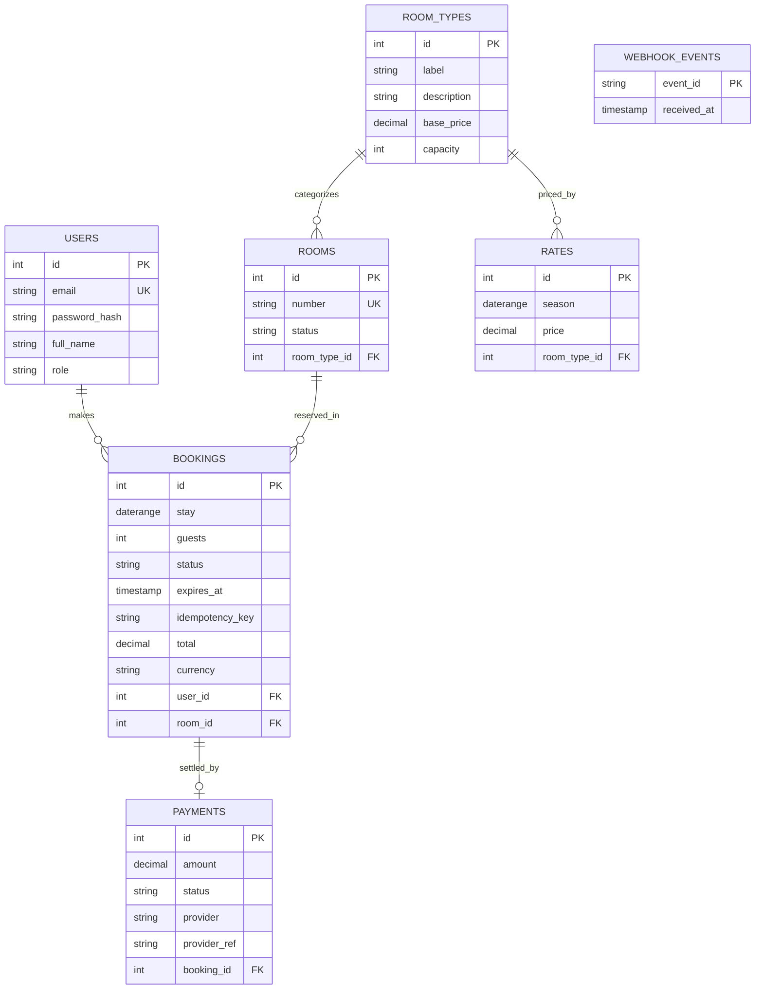

# Hotel Medina


**A booking engine that cannot be double-booked.** Online reservation platform for a riad-style hotel in Fès, Morocco, built around the hard parts of booking systems: concurrency-safe availability, time-limited holds, idempotent requests and a webhook-driven payment flow.

> Payments run in **test mode only**. With Stripe configured, use card `4242 4242 4242 4242`, any future date, any CVC. Without Stripe keys the app uses a mock payment provider that goes through the same confirmation code.

| Demo account | Email | Password |
|---|---|---|
| Guest | guest@demo.test | `demo1234` |
| Staff | staff@demo.test | `demo1234` |

## Table of contents

- [The problem](#the-problem)
- [Technical highlights](#technical-highlights)
- [Architecture](#architecture)
- [Data model](#data-model)
- [Key decisions](#key-decisions)
- [Run locally (for contributors)](#run-locally-for-contributors)
- [Testing strategy](#testing-strategy)
- [Deployment](#deployment)
- [API reference](#api-reference)
- [Project status](#project-status)
- [Roadmap](#roadmap)

## The problem

A small hotel loses money and trust when two guests are confirmed for the same room on the same night. Naive implementations check availability in application code and then insert a booking, which breaks as soon as two requests arrive at the same time. Hotel Medina treats this as the core engineering problem and builds everything else around it.

## Technical highlights

- **Double-booking is impossible at the database level.** A PostgreSQL exclusion constraint on a `daterange` rejects overlapping stays for the same room, regardless of how many API instances are running ([ADR-001](docs/adr/001-exclusion-constraint.md)).
- **Concurrency is tested against a real PostgreSQL.** The suite includes a test that fires many simultaneous booking requests at one room and asserts that exactly one succeeds.
- **Holds with expiry.** A booking starts as `PENDING` with a 15-minute hold (`HOLD_MINUTES`). Unpaid holds are released lazily on search and booking, and by the `expire-holds` CLI command ([ADR-003](docs/adr/003-booking-holds.md)).
- **Idempotent booking creation.** `POST /api/bookings` accepts an `Idempotency-Key` header, so client retries never create duplicates.
- **Payments confirmed only by webhook.** Stripe signature verification and event-id deduplication; the mock provider feeds the same handler ([ADR-004](docs/adr/004-payment-webhooks.md)).
- **Pricing engine as pure functions.** Seasonal rates, length-of-stay discounts and a configurable tourist tax, with property-based tests (Hypothesis).
- **Production-minded setup.** CI on every push, typed code (mypy), linted and formatted (ruff), migrations (Alembic), Docker, Render and Vercel auto-deploy configuration.

## Architecture



The backend separates routes (HTTP), services (business rules) and models (persistence), so booking and pricing logic can be tested without the web layer ([ADR-002](docs/adr/002-service-layer.md)). Expired holds are released lazily by the service layer and, optionally, by a scheduled `flask --app wsgi expire-holds`; there is no worker process.

Authentication uses short-lived JWTs (60 minutes) carrying the user id and role (`guest` or `staff`). Each endpoint declares the roles allowed to call it.

| Piece | Choice |
|---|---|
| Backend | Python 3.11+, Flask 3, SQLAlchemy 2, Alembic (Flask-Migrate), psycopg 3, PyJWT, OpenAPI at `/api/docs` |
| Database | PostgreSQL 15+ with the `btree_gist` extension |
| Frontend | React 18, Vite, Tailwind CSS, react-router, i18next (fr, en), Vitest + Testing Library |

```
hotel-medina/
├── backend/
│   ├── app/
│   │   ├── models/
│   │   ├── routes/
│   │   └── services/        # booking, pricing, payments
│   ├── migrations/
│   ├── tests/
│   ├── wsgi.py              # gunicorn entry point (wsgi:app)
│   └── Dockerfile
├── frontend/
│   ├── src/
│   ├── Dockerfile           # node build, nginx serve
│   └── vercel.json
├── docs/
│   ├── adr/                 # architecture decision records
│   ├── api.md               # API contract
│   └── deployment.md
├── .github/workflows/       # CI
├── docker-compose.yml
├── render.yaml              # Render blueprint for the API
└── Makefile
```

## Data model



`webhook_events` stands alone: it records processed provider event ids so duplicate deliveries have no effect.

The no-overlap guarantee is enforced by the database (created by the Alembic migration, after `CREATE EXTENSION IF NOT EXISTS btree_gist`):

```sql
-- no two active bookings overlap on the same room
ALTER TABLE bookings ADD CONSTRAINT no_overlapping_stays
  EXCLUDE USING gist (room_id WITH =, stay WITH &&)
  WHERE (status IN ('PENDING', 'CONFIRMED'));
```

Seasonal rates have a similar constraint (`no_overlapping_rates`) and booking creation is made idempotent by a unique index on `(user_id, idempotency_key)`. See [`docs/api.md`](docs/api.md) for the full SQL.

## Key decisions

Short write-ups explaining the trade-offs live in [`docs/adr/`](docs/adr/):

- [ADR-001: Database exclusion constraint instead of application-level locking](docs/adr/001-exclusion-constraint.md)
- [ADR-002: Service layer between routes and models](docs/adr/002-service-layer.md)
- [ADR-003: PENDING holds with lazy expiry and a CLI job](docs/adr/003-booking-holds.md)
- [ADR-004: Webhook as the only path to CONFIRMED](docs/adr/004-payment-webhooks.md)

## Run locally (for contributors)

Requirements: Docker and Docker Compose. For work outside Docker you also need Python 3.12 (3.11+ is supported) and Node 22.

```bash
git clone https://github.com/yvsn11/hotel-medina.git
cd hotel-medina
cp .env.example .env      # optional: compose has working defaults
docker compose up --build
```

On start the API applies migrations and loads the demo data, then serves with gunicorn. Payments use the mock provider unless you set Stripe keys.

| Service | URL |
|---|---|
| Web app | http://localhost:5173 |
| API | http://localhost:5000 |
| API docs | http://localhost:5000/api/docs |
| PostgreSQL (loopback only) | `127.0.0.1:5433`, user, password and database `medina` |

Useful commands:

```bash
make help          # list targets
make dev           # build and start db, api and web
make test-db       # start the compose database and create the medina_test database
make test          # backend pytest (coverage gate) + frontend tests
make migrate       # apply database migrations (host, uses DATABASE_URL)
make seed          # load demo rooms, rates and accounts (host, uses DATABASE_URL)
make lint          # ruff check, ruff format --check, mypy, eslint
make down          # stop containers
make clean         # stop containers and delete the database volume
```

Host targets use `backend/.venv` when it exists:

```bash
python -m venv backend/.venv
. backend/.venv/bin/activate && pip install -r backend/requirements.txt
```

Configuration is read from environment variables only. See [`.env.example`](.env.example) for the full list: `DATABASE_URL`, `TEST_DATABASE_URL`, `JWT_SECRET`, `CORS_ORIGINS`, `HOLD_MINUTES`, `TOURIST_TAX_PER_PERSON_NIGHT`, `PAYMENT_PROVIDER`, `STRIPE_SECRET_KEY`, `STRIPE_WEBHOOK_SECRET`, `VITE_API_URL` and `VITE_STRIPE_PUBLISHABLE_KEY`.

## Testing strategy

| Layer | Tools | What is covered |
|---|---|---|
| Pricing | pytest, Hypothesis | Seasonal rates, discounts and taxes, with property-based tests (price never negative, longer stays never cost less in total) |
| Booking service | pytest | Lifecycle, cancellation rules, hold expiry |
| Concurrency | pytest, threads | Simultaneous requests on one room: exactly one succeeds |
| API | pytest, Flask test client | Auth, role checks, validation, idempotency |
| Payments | pytest | Webhook signature verification, duplicate events, mock provider |
| Frontend | Vitest, Testing Library | Search and booking flow |

Backend tests need a real PostgreSQL (`TEST_DATABASE_URL`) because they rely on `btree_gist` and exclusion constraints. Coverage target: 85% on `backend/app/services`; CI fails below the threshold.

## Deployment

The repository is set up for auto-deploy on push to `main`: CI builds and tests, and the hosting providers redeploy from the connected repository. There is no custom deploy workflow and no deploy secrets in the repo.

| Piece | Host | Config |
|---|---|---|
| React frontend | Vercel | [`frontend/vercel.json`](frontend/vercel.json) |
| Flask API (gunicorn, Docker) | Render | [`render.yaml`](render.yaml) |
| PostgreSQL 15 (with `btree_gist`) | Neon | `DATABASE_URL` |

Migrations and seed run as the Render pre-deploy step (`flask --app wsgi db upgrade && flask --app wsgi seed`). A health check is exposed at `/api/health`. See [`docs/deployment.md`](docs/deployment.md) for the step-by-step guide.

## API reference

All endpoints are under `/api` and return errors as `{ "error", "message", "details" }`.

| Method | Endpoint | Access | Description |
|---|---|---|---|
| GET | `/api/health` | Public | Liveness check (also checks the database) |
| POST | `/api/auth/register` | Public | Create a guest account |
| POST | `/api/auth/login` | Public | Authenticate and receive a JWT |
| GET | `/api/rooms/available` | Public | Available room types and total price for `from`, `to`, `guests` |
| POST | `/api/bookings` | Guest, staff | Create a `PENDING` booking (supports `Idempotency-Key`) |
| GET | `/api/bookings` | Guest, staff | List my bookings (staff: all, optional `?status=`) |
| GET | `/api/bookings/{id}` | Owner, staff | Retrieve a booking |
| DELETE | `/api/bookings/{id}` | Owner, staff | Cancel a booking |
| POST | `/api/bookings/{id}/pay` | Owner | Start payment (Stripe PaymentIntent or mock) |
| POST | `/api/payments/mock/confirm` | Owner | Confirm a mock payment (mock provider only) |
| POST | `/api/payments/webhook` | Stripe | Receive signed payment events |
| GET | `/api/rooms` | Staff | List rooms |
| PUT | `/api/rooms/{id}` | Staff | Update a room number or status |
| PUT | `/api/room-types/{id}` | Staff | Update a room type |
| GET, POST | `/api/room-types/{id}/rates` | Staff | List or add seasonal rates |

Full reference: [`docs/api.md`](docs/api.md), or the interactive OpenAPI docs at `/api/docs`.

## Project status

| Area | Status | Notes |
|---|---|---|
| Schema, migrations, exclusion constraint | Done | Migration tested against real PostgreSQL: constraints exist and reject overlaps |
| Availability search | Done | |
| Booking service and concurrency test | Done | 50 threads on a single room: 1 booking created, 49 refused. The test fails if the constraint is removed |
| Pricing engine | Done | Example and property-based tests |
| Auth (guest, staff) | Done | JWT, role checks, guests cannot read other guests' bookings |
| Payments, mock provider | Done | Mock confirmation goes through the same handler as the webhook |
| Payments, Stripe test mode | In progress | Webhook signature verification is tested with signed payloads. PaymentIntent creation and the Stripe Payment Element in the UI have not been run against Stripe |
| React UI (search, book, pay, my bookings, staff) | In progress | 24 component and flow tests pass and the production build works. Visual review in a browser and screenshots are still to do |
| CI | In progress | Workflow is written but has not yet run on GitHub |
| Live deployment | Planned | Config for Render and Vercel is included, see [`docs/deployment.md`](docs/deployment.md) |

Last local verification: backend 181 tests passing with 98% coverage on `app/services` (ruff and mypy clean), frontend lint, 24 tests and build passing, and a manual end-to-end run (login, availability, booking, repeated booking refused with 409, mock payment to `CONFIRMED`). Docker images and `docker compose up` have not been built or run yet.

Known limitations: cancelling a confirmed booking does not trigger a refund, there is no login rate limiting, and the staff screen edits room status and base price only (seasonal rates are available through the API).

## Roadmap

Not in scope today:

- iCal import/export to sync availability with Booking.com and Airbnb
- Arabic translation with right-to-left layout (French and English first)
- Staff dashboard: occupancy rate and revenue
- Email confirmations
- Invoicing and front-desk check-in / check-out
- Refund handling for payments that arrive after a hold expired
- A scheduler for `expire-holds` (today: lazy expiry, plus cron if you add one)

## License

[MIT](LICENSE)
